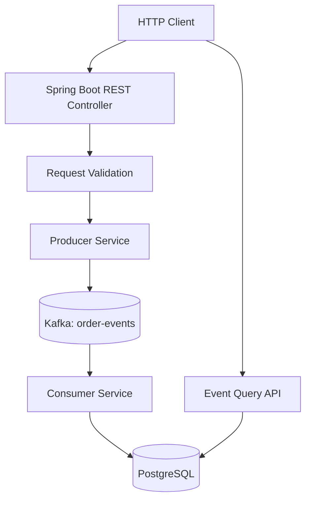

# Event Processing Platform — Architecture

## 1. Purpose

Build a backend system that accepts order requests, publishes order-created events to Apache Kafka, processes those events asynchronously, and stores processing results in PostgreSQL.

The primary learning goals are asynchronous processing, Kafka producer/consumer behavior, database persistence, idempotency, failure handling, and automated testing.

## 2. Scope

### Initial version

- Accept and validate order requests through a REST API.
- Publish order-created events to the `order-events` Kafka topic.
- Consume events asynchronously.
- Persist processed event records in PostgreSQL.
- Enforce uniqueness of event IDs.
- Expose APIs to retrieve processed events.
- Test duplicate delivery and common failure scenarios.

### Out of scope initially

- Authentication and authorization.
- Multiple independently deployed microservices.
- Payment processing or real financial transactions.
- Multi-broker production deployment.
- Guaranteed end-to-end exactly-once processing.
- Transactional outbox implementation (planned extension).

## 3. Architecture

The producer and consumer initially run inside one Spring Boot application. They remain separate logical components so their responsibilities can be understood and tested independently.

## 4. Components

### REST API

- Accepts order creation requests.
- Validates required fields and business constraints.
- Returns an event ID when publishing is accepted.
- Exposes queries for persisted event records.

### Producer service

- Creates an event ID.
- Builds the event envelope defined in `event-contract.md`.
- Publishes the event to Kafka.
- Reports publication failures instead of claiming success when publication has failed.

### Kafka

- Stores event records in the `order-events` topic.
- Provides partitioned, ordered logs.
- Allows consumers to read records independently of the original HTTP request.

The local setup will begin with a single partition. Partitioning and consumer concurrency will be explored later.

### Consumer service

- Reads records from Kafka.
- Deserializes and validates events.
- Processes each event.
- Persists the processing result.
- Handles duplicate deliveries safely.

Initial consumer group: `order-event-processors`.

### PostgreSQL

Stores processed event records and their processing status. The event ID will have a database uniqueness constraint.

The database is the query source for the event retrieval endpoints.

## 5. Data flow

1. A client submits an order request.
2. The REST API validates the request.
3. The producer creates an event and publishes it to Kafka.
4. After successful publication is acknowledged, the API responds with HTTP `202 Accepted` and the event ID.
5. A consumer reads the event independently of the HTTP request.
6. The consumer persists the result in PostgreSQL.
7. The query API can retrieve the persisted record.

Processing is asynchronous. A successful HTTP response means that publication was accepted; it does not mean the database write has completed.

In this initial design, an event may not be visible through the database-backed query API until the consumer persists it. A query made before that point may return `404 Not Found`. This limitation is intentional and will be reconsidered if we introduce a separate event-status registry.

## 6. API outline

| Method | Endpoint                | Initial behavior                      |
| ------ | ----------------------- | ------------------------------------- |
| POST   | `/api/orders`           | Validate request and publish an event |
| GET    | `/api/events/{eventId}` | Retrieve a persisted event record     |
| GET    | `/api/events`           | List persisted event records          |

The precise request and response structures will be documented alongside the implementation and tests.

## 7. Reliability considerations

### Duplicate delivery

A consumer may process a record again if it writes to PostgreSQL and crashes before committing its Kafka offset.

The database will enforce event ID uniqueness, and processing will be designed to avoid applying the same event twice.

### Database and Kafka are separate systems

A database transaction does not automatically include a Kafka offset commit. Publishing an event and writing application state to PostgreSQL are also separate operations.

The initial version does not solve every dual-write failure scenario. A transactional outbox is a planned extension.

### Failed events

A permanently invalid event must not block processing indefinitely. We will add bounded retry behavior and a dead-letter topic after the basic pipeline works.

### Delivery semantics

We will document the observed behavior and the guarantees actually implemented. We will not claim end-to-end exactly-once processing.

## 8. Technology choices

- Java
- Spring Boot
- Spring for Apache Kafka
- Apache Kafka
- PostgreSQL
- Spring Data JPA
- Maven
- Docker Compose
- JUnit and Spring Boot testing support

Testcontainers and additional observability tools may be introduced in later iterations.

## 9. Initial success criteria

- The application starts locally.
- A valid request can publish an event.
- Kafka contains the published record.
- The consumer can read and persist the event.
- The query API can retrieve persisted events.
- Duplicate delivery does not create duplicate event rows.
- Failure scenarios have reproducible tests or documented experiments.
- The setup and architecture can be explained and reproduced from the README.

## 10. Known limitations

This is a learning system, not a production-ready order platform. It initially runs as one application, uses a local Kafka environment, and has a deliberately limited recovery design.

Production deployment would require additional consideration of security, monitoring, scaling, schema evolution, database migrations, disaster recovery, and delivery guarantees.
